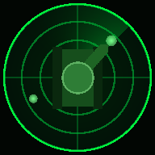
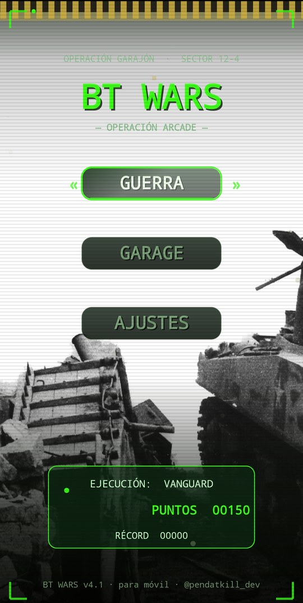
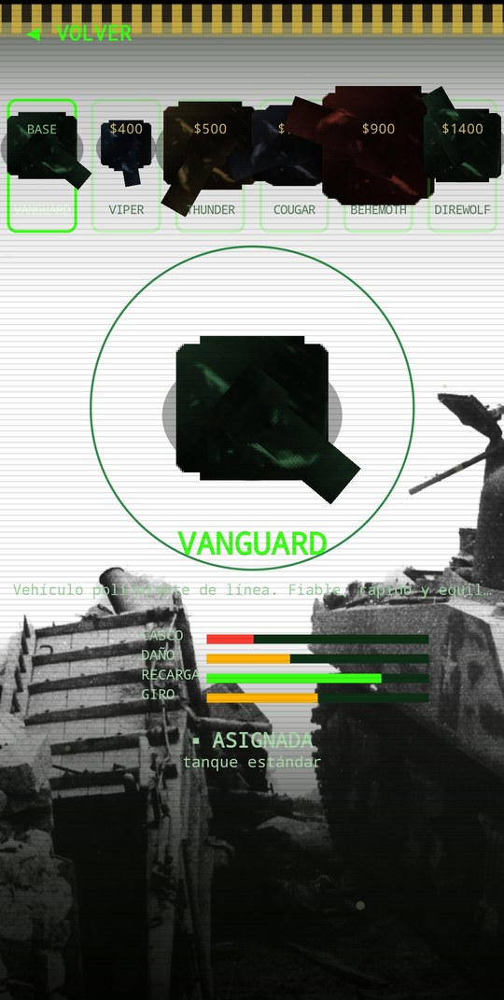
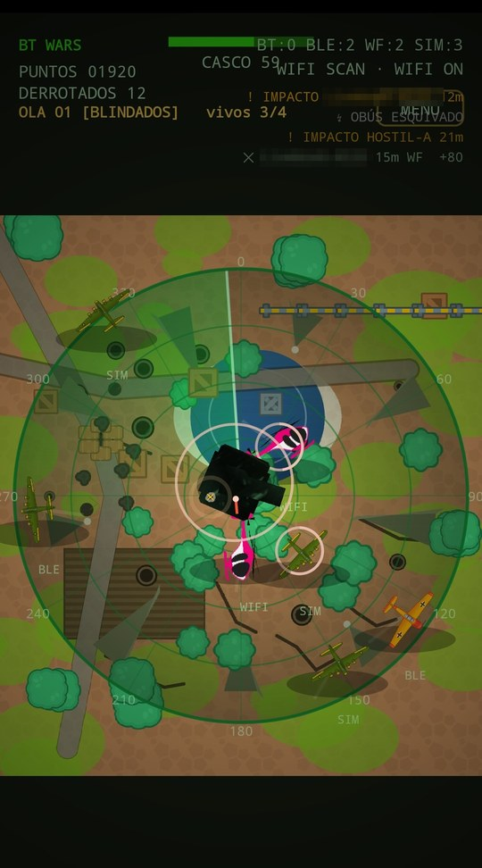

  

<h1 align="center">BT WARS</h1>

  <b>— OPERACIÓN ARCADE —</b> 
  Un radar de combate en tu móvil: los dispositivos Bluetooth y WiFi que te rodean se convierten en carros enemigos.

  
  
  
  
  

  
  
  

---

## ¿Qué es?

**BT Wars** convierte lo que tu móvil "oye" a su alrededor en un campo de batalla. La app escanea los dispositivos **Bluetooth clásico**, **Bluetooth Low Energy** y las **redes WiFi** cercanas, y cada uno aparece en el radar como un enemigo: su distancia aproximada sale de la intensidad de la señal. Tú eres el carro del centro. Toca a los hostiles para disparar antes de que te alcancen.

Sin Bluetooth ni permisos también se puede jugar en **modo entrenamiento**, con objetivos simulados.

## Características

| | |
|---|---|
| 📡 **Radar real** | Detecta dispositivos BT, BLE y WiFi cercanos y los muestra con su rumbo y distancia estimada. |
| 🎯 **Combate por toques** | Toca un contacto dentro del radar para disparar. Los enemigos te devuelven el fuego. |
| 🌊 **Oleadas** | Oleadas temáticas (Halcones, Blindados, Escaramuzas, Caballería, Abismo, Fatum) con refuerzos y bonus al superarlas. |
| 💥 **Combos y mejoras** | Multiplicador de combo, cajas con Escudo, Ráfaga, Dobles x2, Reparación de casco y pulso EMP. |
| 🛡️ **Garaje con 6 carros** | Vanguard, Viper, Thunder, Cougar, Behemoth y Direwolf, cada uno con casco, daño, recarga y giro distintos. Se compran con los puntos ganados. |
| 🗺️ **Campo de batalla vivo** | Terreno con árboles, cráteres, cajas, vallas, aviones y helicópteros, humo y explosiones animadas. |
| 🧪 **Modo entrenamiento** | Objetivos simulados para jugar sin Bluetooth ni permisos. |
| 🔊 **Sonido sintetizado** | Ping de radar, disparos y explosiones generados por la propia app. |

## Cómo se juega

1. **GUERRA** inicia la batalla. La primera vez la app explica y pide los permisos de Bluetooth y ubicación.
2. Tu carro está en el centro. La barra de barrido gira y revela los contactos: **BT**, **BLE**, **WF** (WiFi) o **SIM** (simulado).
3. **Toca un enemigo** para disparar. Toca las cajas para recoger mejoras.
4. Cada derribo suma puntos y combo. Al acabar la partida, los puntos se guardan para comprar carros en el **GARAGE**.
5. En **AJUSTES** puedes activar o desactivar el sonido.

## Permisos y privacidad

| Permiso | Para qué |
|---|---|
| Bluetooth (buscar dispositivos cercanos) | Detectar dispositivos BT y BLE como enemigos. |
| Ubicación | Android la exige para poder escanear Bluetooth y WiFi. **La app no lee tu posición.** |
| Estado del WiFi | Lanzar el escaneo de redes cercanas. |

- La app **no tiene permiso de internet**: nada sale del móvil.
- Los dispositivos detectados solo se usan en memoria mientras juegas y **no se guardan**.
- Solo se guardan en el móvil tus puntos, el récord, el carro elegido y el sonido.

Política completa: [docs/PRIVACIDAD.md](docs/PRIVACIDAD.md).

> En el modo real aparecen en pantalla los nombres de los dispositivos y redes cercanas. Si compartes capturas, tápalos o usa el modo entrenamiento.

## Descargar e instalar

1. Ve a [**Releases**](../../releases/latest) y descarga `BT-Wars-v4.2.apk`.
2. Ábrelo en el móvil y permite *instalar apps de origen desconocido* solo para esta instalación.
3. Si tenías una versión anterior, desinstálala antes, porque la firma ha cambiado en la 4.2.

## Tecnología

- Java nativo para Android, sin librerías externas.
- Todo el juego se dibuja a mano sobre `Canvas` en vistas propias (`MenuView`, `RadarView`).
- Escaneo con `BluetoothAdapter` (descubrimiento clásico), `BluetoothLeScanner` (BLE) y `WifiManager`.
- Efectos de sonido sintetizados en tiempo real.

## Créditos

- **Diseño, código y sonido:** pendatkill-dev.
- Algunos recursos gráficos (sprites de vehículos y la fotografía del fondo del menú) proceden de fuentes externas y mantienen sus licencias originales.

## Historial

Consulta [CHANGELOG.md](CHANGELOG.md).

## Licencia

© 2026 pendatkill-dev. Todos los derechos reservados. Consulta [LICENSE](LICENSE).

---

  Hecho por <a href="https://github.com/Pendatkill"><b>pendatkill-dev</b></a> · <i>@pendatkill_dev</i>

